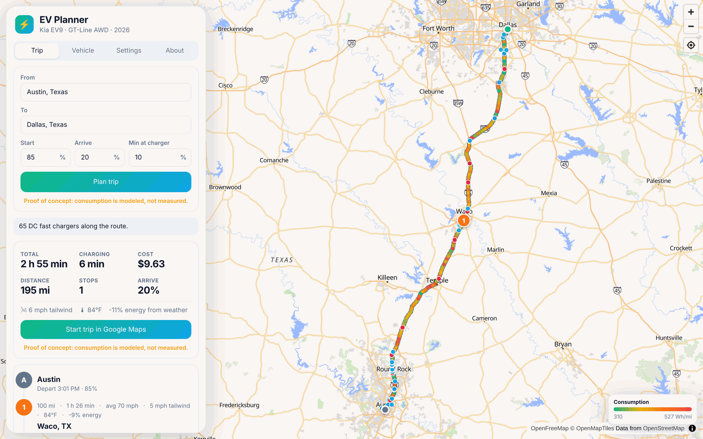
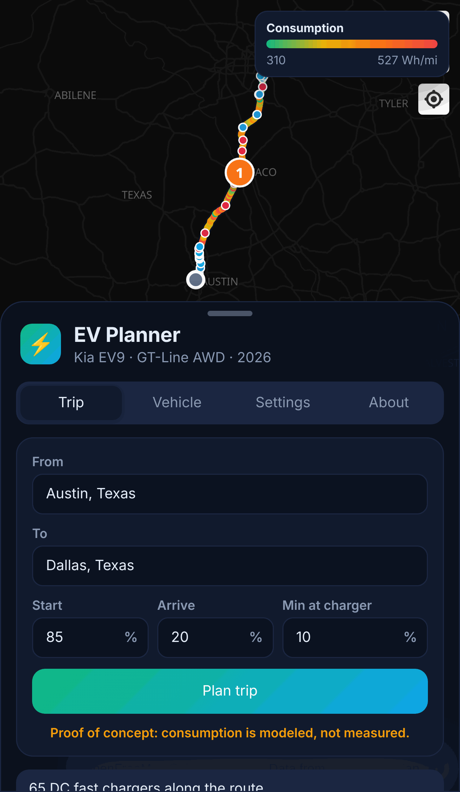
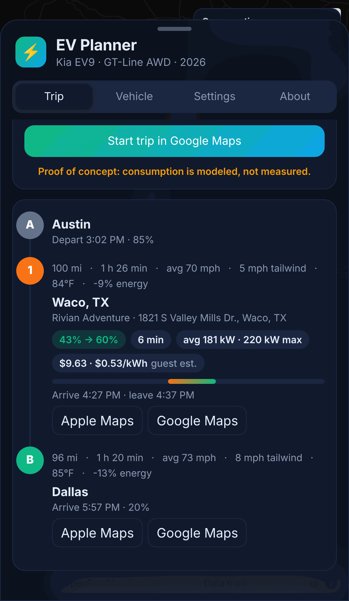
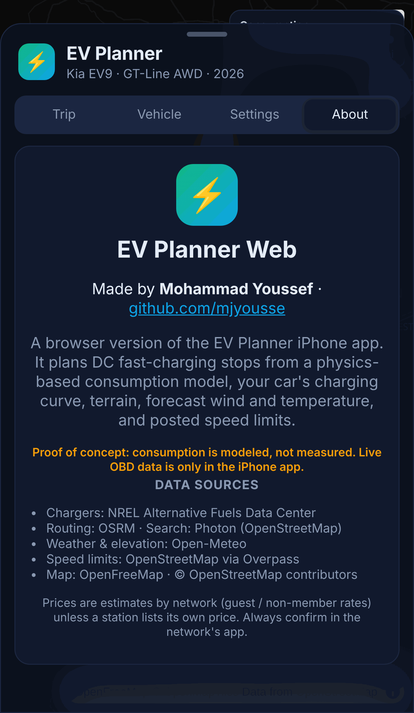
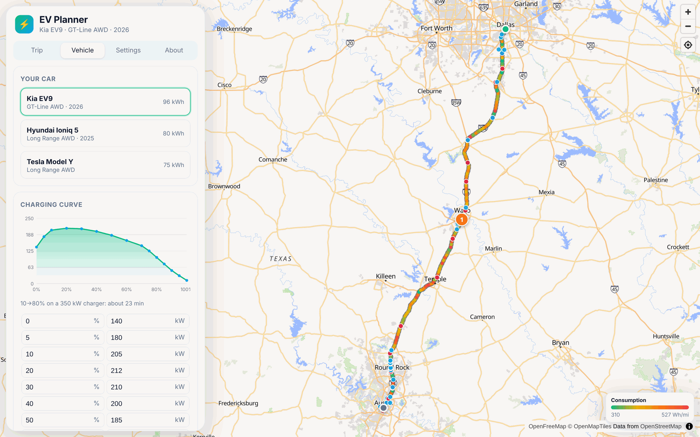
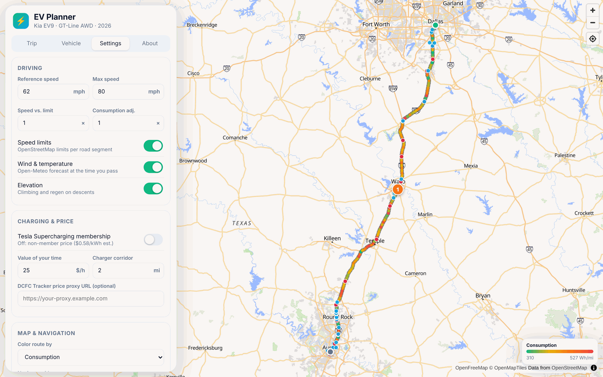

<div align="center">


# EV Planner Web

**EV road-trip planning in the browser: charging stops from your car's real charging curve, terrain, forecast wind, speed limits and price estimates.**

Built by **Mohammad Youssef** · [github.com/mjyousse](https://github.com/mjyousse)


</div>

> **Proof of concept: consumption is modeled, not measured.** This web version has no live OBD data. It is the companion to the EV Planner iPhone app, which adds live battery data from a Bluetooth OBD adapter and replans as you drive.

<p align="center">
  
</p>

<p align="center">
  
  
  
</p>

## Features

- **Map-first planner.** Full-screen MapLibre map with OpenFreeMap tiles, the route colored by modeled consumption or driving speed, every DC fast charger along the corridor, and numbered charging stops.
- **Optimal charging stops.** A shortest-path search over (charger, departure %) states balances drive time, charge time, stop overhead and cost. It meets your start %, arrival % and minimum-at-charger limits.
- **Your car's charging curve.** Built-in profiles for the 2026 Kia EV9 GT-Line (default), Hyundai Ioniq 5 Long Range and Tesla Model Y Long Range. Every value and curve point is editable, with a live chart.
- **Physics-based consumption.** Rolling resistance with payload, aerodynamic drag from CdA, climbing and regen from Open-Meteo elevation, and auxiliary load.
- **Weather.** Open-Meteo wind and temperature at the time you pass each point. Includes the headwind component along each segment, air density, and cabin and battery temperature penalties.
- **Speed limits.** OpenStreetMap `maxspeed` via Overpass, falling back to typical limits by road class and then to router speeds. A reference speed (62 mph), max speed (80 mph) and a speed-vs-limit factor shape the model.
- **Price estimates.** Guest rates by network, with Tesla Superchargers at the **non-member** price ($0.58/kWh) and a membership toggle that's off by default. Station-listed $/kWh is used when NREL has it, and there's a provider hook for DCFC Tracker.
- **Hand-off to navigation.** Apple Maps and Google Maps buttons on every stop, plus **Start trip in Google Maps** with all charging stops as waypoints.
- **Works like an app on iPhone.** Responsive bottom sheet, dark mode, PWA manifest and home-screen icon.

<p align="center">
  
  
</p>

## Use it on iPhone

1. Open the site in Safari.
2. Tap **Share**, then **Add to Home Screen**.
3. Optional: in **Settings**, paste your own free NREL key from [developer.nlr.gov/signup](https://developer.nlr.gov/signup/). `DEMO_KEY` works but is limited to a few plans an hour. The key is stored only in your browser.

## How planning works

1. **Route.** OSRM gives the driving route, resampled to about 1 km points.
2. **Enrich.** Elevation (every 2 km), weather at your ETA (every 20 km) and speed limits (every 5 km) are attached to each point.
3. **Energy.** `RouteEnergy` builds cumulative kWh, minutes and weather along the route, so any leg's energy can be looked up in O(log n).
4. **Chargers.** NREL's `nearby-route` endpoint returns open, public DC fast chargers within the corridor. Each one is pruned to the strongest station per 2 km.
5. **Search.** Dijkstra over (charger, departure %) states. Each edge costs drive time, plus 4 minutes of stop overhead, plus charge time integrated over the curve (capped by the charger and slowed in the cold), plus money divided by your value of time.

```
src/
  engine/      vehicles, charge curve, energy model, planner, pricing (pure, unit-tested)
  services/    OSRM, Photon, NREL, Open-Meteo, Overpass, map links
  main.ts      UI, map and state
tests/         vitest suites for charge time, energy and planner
```

## Pricing

| Network | $/kWh | Label |
| --- | --- | --- |
| Tesla Supercharger | 0.58 (0.43 with membership) | non-member est. |
| Electrify America | 0.56 | guest est. |
| EVgo | 0.62 | guest est. |
| ChargePoint | 0.49 | guest est. |
| IONNA | 0.55 | guest est. |
| Rivian Adventure | 0.53 | guest est. |
| bp pulse | 0.59 | guest est. |
| Shell Recharge | 0.55 | guest est. |
| Others | 0.52 | guest est. |

These are typical rates, not live prices. `DCFCTrackerProxyPricingProvider` accepts a URL for a small private proxy that keeps a DCFC Tracker Pro key server-side (as their terms require). Set the URL in Settings once a proxy exists.

## Develop

```bash
npm install
npm run dev      # local dev server
npm test         # vitest
npm run build    # static site in dist/
```

Every push to `main` runs the tests, builds the site and publishes it to the `gh-pages` branch through GitHub Actions.

## Data sources

Chargers: [NREL Alternative Fuels Data Center](https://afdc.energy.gov/) · Routing: [OSRM](https://project-osrm.org/) · Search: [Photon](https://photon.komoot.io/) · Weather and elevation: [Open-Meteo](https://open-meteo.com/) · Speed limits: [OpenStreetMap](https://www.openstreetmap.org/copyright) via Overpass · Map: [OpenFreeMap](https://openfreemap.org/)

The public routing, search and Overpass servers are free community services with fair-use limits, so plans can occasionally be slow or skip speed limits when they are busy.

## License

[MIT](LICENSE) © 2026 Mohammad Youssef
